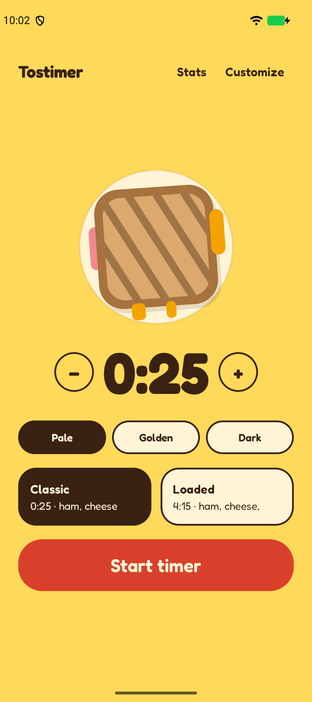
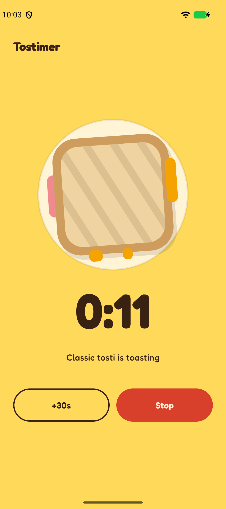
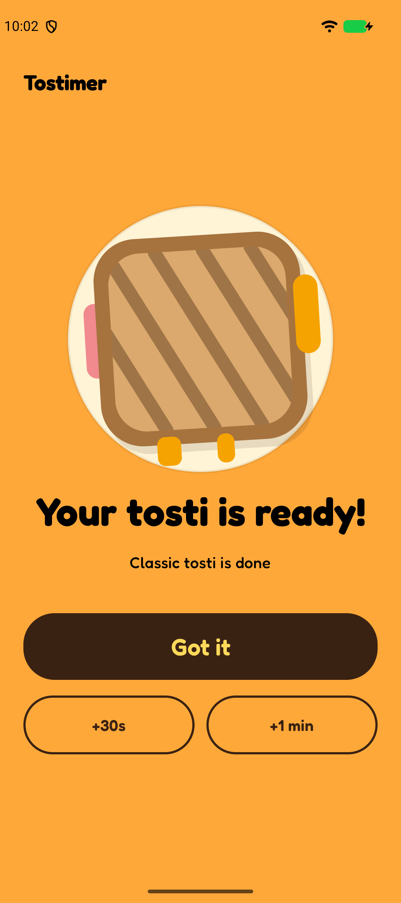
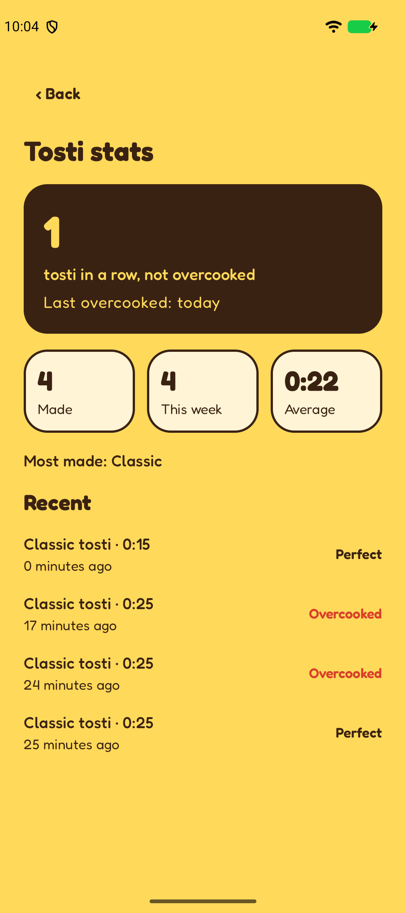
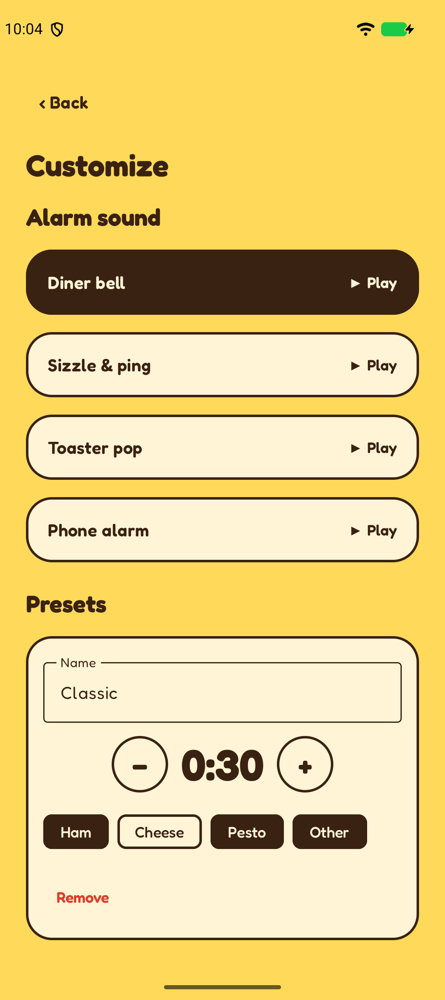
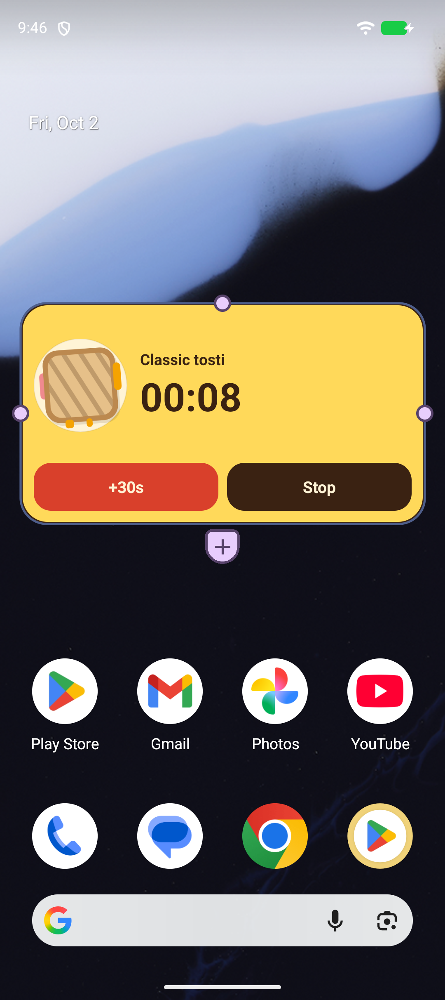

# Tostimer

A timer for people who put a tosti in the iron, go back to work, and forget about it.

Tostimer rings a loud alarm that wakes the screen, even when the phone is locked or the app is closed, and it keeps nagging until you deal with it. It also draws your tosti and browns it while the timer runs, because why not.

<p>
  
  
  
  
  
</p>

## Download

Grab the latest APK from the [Releases page](https://github.com/BigRoelof/Tostimer/releases/latest) and open it on your Android phone (Android 8.0 or newer).

Android will ask you to allow installs from your browser or file manager, because the app is not on the Play Store. The APK is signed, so later releases install over this one and keep your presets and stats.

## What it does

- **Reliable alarm.** An exact system alarm fires on time, shows a full-screen "Your tosti is ready!" screen over the lock screen, and loops a sound until you react. It gets louder and changes its message after 2 minutes, and gives up after 10.
- **Doneness.** Pale, Golden or Dark scales the time, and the tosti drawing previews how toasted it will be.
- **Presets.** Name them, set the time, and pick any mix of ham, cheese, pesto and other. Every ingredient shows on the tosti.
- **Alarm sounds.** Diner bell, sizzle and ping, toaster pop, or your phone's alarm sound.
- **Stats.** How many tostis you made, your average time, a streak of tostis in a row that weren't overcooked, and how long since the last one that was. A tosti counts as overcooked if the alarm went unanswered for 2 minutes.
- **Home-screen widget.** Start a preset in one tap, watch the countdown and see the tosti brown live, without opening the app.
- **Notification.** A live countdown with +30s and Stop buttons, and an "almost done" heads-up at 80% of the time.



## Tips for Samsung and other aggressive phones

The alarm is a system alarm, so it should survive battery savers. If it ever does not ring, check these first:

- Settings → Apps → Tostimer → Battery → **Unrestricted**
- Make sure Tostimer is not in "Sleeping apps" or "Deep sleeping apps"
- Android 14 and newer: allow the full-screen alarm when the app asks. Without it you still get the sound and a heads-up notification.

## Permissions

| Permission | Why |
| --- | --- |
| Notifications | The countdown, the almost-done alert and the alarm |
| Exact alarms | Ringing at the second the tosti is done |
| Full-screen intent | Showing the alarm screen over the lock screen |
| Foreground service (media playback) | Playing the alarm sound while the screen is off |
| Vibrate, wake lock | Vibrating and keeping the phone awake while it rings |
| Run at startup | Re-arming a running timer after a reboot |

The app has no internet access and sends nothing anywhere. Presets and stats stay on your phone.

## Build it yourself

You need JDK 17 or newer and the Android SDK with platform 36.

```sh
git clone git@github.com:BigRoelof/Tostimer.git
cd Tostimer
echo "sdk.dir=$HOME/Android/Sdk" > local.properties   # path to your Android SDK
./gradlew assembleDebug                                # app/build/outputs/apk/debug/app-debug.apk
```

For a release build, put a `keystore.properties` file (`storeFile`, `storePassword`, `keyAlias`, `keyPassword`) in the project root or in `~/.tostimer-signing/` and run `./gradlew assembleRelease`. Without one, the release APK is left unsigned. Signing files are git-ignored.

## How it is built

Kotlin and Jetpack Compose, with no third-party libraries beyond AndroidX.

| Area | Where |
| --- | --- |
| Timer state, alarm scheduling, stats on stop | `TimerManager.kt` |
| Alarm sound and vibration | `AlarmService.kt` |
| Notifications | `Notifier.kt` |
| Presets, settings and stats storage | `Store.kt` |
| Widget (RemoteViews, tosti rendered as a bitmap) | `TostiWidgetProvider.kt` |
| Screens and the tosti drawing | `ui/` |

The timer state is saved, and the wake-up is an `AlarmManager` alarm, so nothing has to stay alive while counting down. The tosti is drawn once in Compose and the same code renders the widget's bitmap.

## Credits

- Font: [Fredoka](https://github.com/hafontia/Fredoka-One), under the SIL Open Font License ([licenses/Fredoka-OFL.txt](licenses/Fredoka-OFL.txt)).
- Alarm sounds are synthesised for this project.
